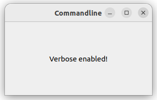

# PySide6 Games

[Home](https://github.com/Erriez/pyside6-getting-started#PySide6-Examples)

## [01_commandline.py](01_commandline.py)



## [02_print_color_names.py](02_print_color_names.py)

```bash
> python .\15_misc\02_print_color_names.py
aliceblue
antiquewhite
aqua
aquamarine
azure
beige
...
```